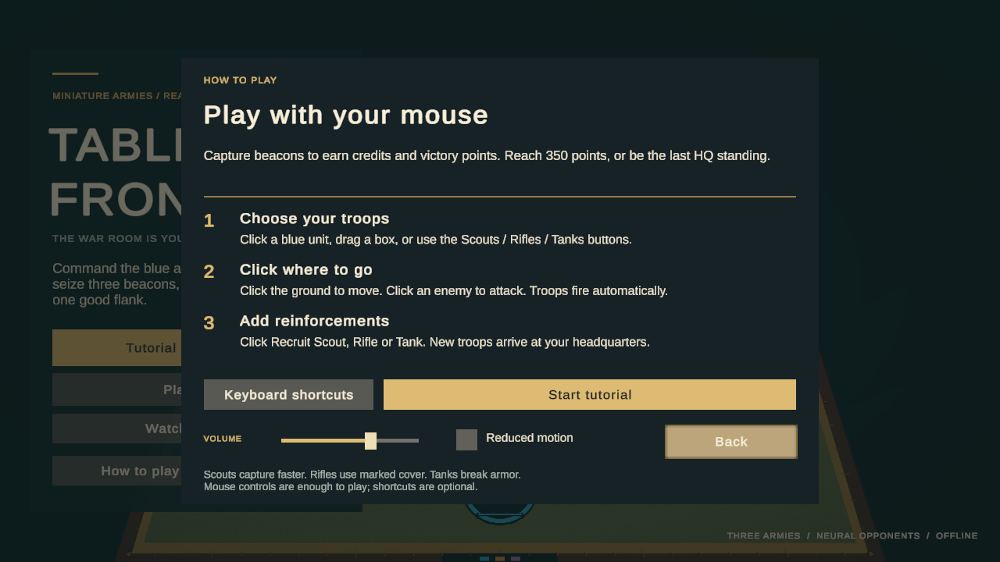
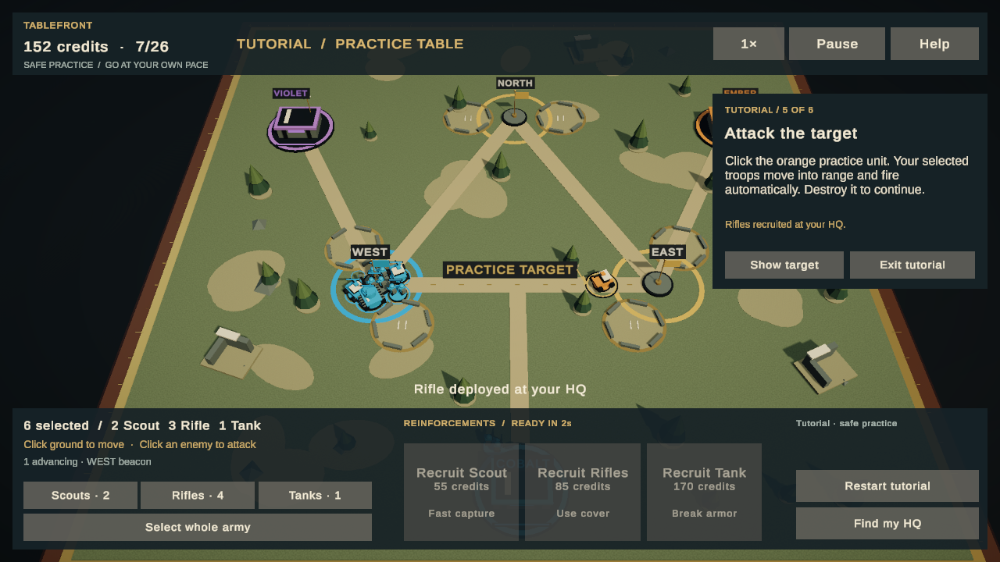

# Tablefront 0.3.1 controls and tutorial

November 22, 2026. This update responds to the user's playtest feedback that the control list was difficult to understand. It preserves the tabletop style and normal combat rules while making the main command flow available through mouse clicks and named buttons. AI training and CudaRL integration remain paused.

## Command with the mouse

1. **Choose troops.** Click a blue miniature, drag a box, or click **Scouts**, **Rifles**, **Tanks** or **Select whole army**. Bright rings identify selected units.
2. **Give an order.** With troops selected, click open ground to move or an enemy to attack. The force stays selected. Click a different friendly unit to select it. Right-click remains an alternative order control.
3. **Add troops.** Click a **Recruit** button. It displays the cost and becomes available when the army has enough credits, space and no recruitment cooldown. New troops appear at the blue HQ.

Clicking a troop-class button never buys troops. The main HUD uses the actual class names rather than asking a new player to remember Alpha/Bravo/Charlie. The optional custom groups remain available through their advanced shortcuts.

The **Let AI play** / **Take control** button explicitly switches command. Tab no longer changes who plays your army; it focuses visible UI controls. The initial Help view explains the three mouse actions. **Keyboard shortcuts** expands the optional key list. Volume and reduced-motion settings remain in Help.

## Six-task practice

Open **Tutorial · Start here** from the title screen. Once completed, this entry reads **Tutorial** and the title's recommended action becomes **Play vs AI**. Tutorial is also available through Help and the pause menu.

| Task | What to do | What completes it |
| --- | --- | --- |
| Select your troops | Click a blue troop, drag a selection box or select the whole army | At least one live friendly is selected |
| Move to the marker | Click the gold **MOVE HERE** marker | An ordered friendly actually reaches the marked area |
| Capture WEST | Click the marked WEST beacon and keep troops inside its ring | Normal capture changes the owner to blue |
| Recruit a rifle squad | Click **Recruit Rifles** | A paid rifle reinforcement is deployed |
| Attack the target | With troops selected, click the orange practice unit | The ordered target is destroyed by normal combat |
| Use rifle cover | Click **Rifles**, then the marked cover | An ordered, selected rifle reaches cover and gains its normal protection |

The lesson uses ordinary movement, recruitment costs, capture and combat. Clicking a destination alone does not complete arrival, capture or destruction tasks. Scouts cannot complete the rifle-cover task, and another troop class cannot complete rifle recruitment. During destination tasks, clicking the marked area gives the lesson's order even if another friendly already occupies it.

Before completion, recruitment is restricted to the rifle-recruitment task so early spending cannot fill the army cap and block that task. Normal battles retain unrestricted class recruitment under the normal cost, cooldown and capacity rules.

This is a separate practice session. Opposing armies are removed, strategic AI and HQ guns are inactive, and the spawned attack target stays still without firing. The normal score/last-HQ victory check is disabled only in practice. There is no countdown pressure to finish the lesson.

**Show target** recenters the camera. **Restart tutorial** clears practice progress and begins again. **Exit tutorial** returns to the title. After the sixth task, **Play a battle** records completion and starts a fresh normal battle with normal armies, opponents and victory rules. Completing the last task alone does not release enemies onto the practice table.

## Optional keys

| Input | Action |
| --- | --- |
| 1 / 2 / 3 | Select Scouts / Rifles / Tanks |
| Z / X / C | Recruit Scout / Rifle / Tank |
| Ctrl+A | Select whole army |
| Shift+click / Shift+drag | Add or remove from selection |
| 4 / 5 / 6 | Recall a custom group |
| Ctrl+4 / Ctrl+5 / Ctrl+6 | Assign a custom group |
| WASD / arrows | Pan the camera |
| Mouse wheel / middle drag | Zoom / pan |
| Q / E | Turn the table |
| Home / F | Focus HQ / active alert |
| Tab / Shift+Tab | Next / previous visible control |
| Enter | Activate focused button |
| Space / Escape | Pause; Space submits a focused UI control instead |
| F1 / F11 | Battle Help / fullscreen |

## Verification

The [runtime verification](../TestResults/controls-tutorial-runtime.txt) records **59 passing checks** using virtual Input System devices and the actual game/simulation. It covers selection and orders through clicks, arrival/capture/destruction gates, wrong-class negative cases, paid recruitment, protection against filling the army cap before the recruitment task, cover, restart/exit, completion into a fresh match, named HUD actions, keyboard mapping, Tab focus without AI takeover, pause and unchanged normal victory rules. The existing [57 mechanics checks](../TestResults/controls-mechanics.txt) and [25 tactical checks](../TestResults/controls-tactics.txt) also pass against the updated simulation.

The [layout matrix](../TestResults/controls-layout-matrix.json) contains **36 rendered captures**: title, mouse Help, advanced shortcuts, tutorial selection/recruitment/attack/cover/completion and battle at **1024×768, 1280×720, 2560×1440 and 3440×1440**. All recorded TMP overflow probes are empty. Representative frames were visually inspected, including the two above; this is not a claim that every frame received an individual visual review. The fix pass shortened clipped lesson feedback and blocked early recruitment that could otherwise fill the army cap. The selection/command markers, six-task coach and preserved tabletop styling are visible in the recorded frames.

The [StandaloneWindows64 build](../TestResults/controls-build-report.json) succeeded with **zero errors and warnings**, producing **107,328,012 bytes**. The [0.3.0 to 0.3.1 per-user upgrade](../TestResults/controls-installer-verification.json) succeeded: all **190 payload hashes** matched, Windows registration showed 0.3.1, and both shortcuts targeted the startup-fix launcher. The actual desktop shortcut opened a responding installed game with completed scene initialization and zero runtime exceptions or shader errors. A read-only native screenshot showed the tutorial practice table at task 1 of 6. No native gameplay input was sent. See [native startup evidence](../TestResults/controls-native-startup.json). QA helpers remain outside Assets and are not part of the game payload.

The frozen commander policy is unchanged: SHA-256 `07ee559f4ae04a0023d0d451757a4bb2772e18c7aec1c52ca89eaefee3052181`. The controls/tutorial update does not train the opponents or make them learn during a match.

## Scoped design review

These conservative scores are internal frame-review heuristics, not measurements of user success. The scope is the changed controls, Help and tutorial shell with the existing tabletop look; it is not a full accessibility or performance certification.

| Dimension | Score / 10 | Evidence and remaining limitation |
| --- | --- | --- |
| Usability | 8 | Mouse actions, named force buttons and real completion gates pass; new-player comprehension has not been observed |
| Hierarchy | 8 | Help has three numbered actions and a prominent tutorial entry; the battle deck still competes with the coach at small desktop sizes |
| Accessibility | 6 | Tab focus, labels and reduced motion exist; there is no complete keyboard-only world-order flow, screen-reader support or text-scale setting |
| Consistency | 8 | Class names, costs, gold targets and selection rings agree across HUD/Help/lesson; optional legacy groups still introduce a second grouping concept |
| Responsiveness | 8 | Four desktop dimensions/aspects render without reported TMP overflow; smaller-window text and control density need human testing, and no mobile port was assessed |
| Feedback | 8 | Selection, destination, target and task completion have visible feedback; shortened copy fixes observed clipping, while audio and feedback comprehension need a human check |
| Performance | 6 | The Windows build succeeds and the simulation regression suite passes; native frame times, input latency and VRAM were not measured |

Prioritized follow-ups for these sub-9 findings:

1. Observe new players complete selection, the first order and the tutorial without coaching; use errors and hesitations to refine hierarchy, wording and targeting before adding more controls.
2. Add a complete keyboard world-command path, text scaling and remappable keys; assess assistive-technology support. Verify focus, contrast and readability through a dedicated accessibility pass.
3. Test the smallest supported desktop window with actual users, then reduce competing deck/coach information if it obstructs play. Evaluate whether advanced custom groups need clearer separation.
4. Measure native frame times, input latency and VRAM on the target machine, and listen to the mix on speakers/headphones. Do not infer these from the simulation throughput or build status.

The scoped six-axis craft board is **palette 4/5, style 4/5, lighting 3/5, silhouette 3/5, UI intentionality 4/5, feedback visibility 4/5**. The frames retain the established sage board, enamel factions, brass markers and ink/ivory UI. Light and class silhouettes remain readable at close range but can flatten at the wide opening, so they are not rated as finished art. The fix pass improved feedback fit and lesson recovery while preserving existing art rather than introducing unrelated visual changes. Human comprehension, fun, ideal difficulty, native performance and complete accessibility remain unvalidated.
