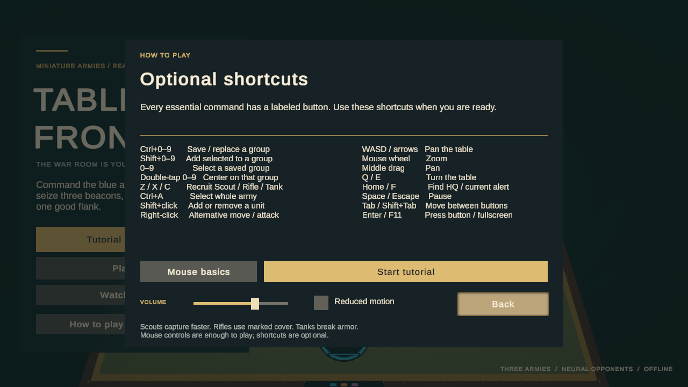
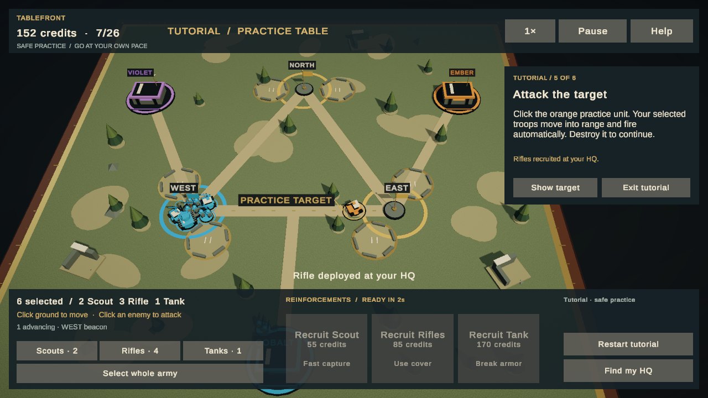

# Tablefront controls and tutorial

The 0.5.0 update adds five unit classes, visible Stop/Hold/Attack-move commands and four skirmish maps; see the [expanded interface](EXPANDED_UI.md) and [release verification](RELEASE_v0.5.0.md). Camera pan uses arrows or middle drag, leaving A/S/H for army orders. The 0.4.1 fix still lets step 5 finish when the marked practice unit is destroyed, including by automatic fire. Its heading reads **TUTORIAL — STEP 1 OF 6**. Version-specific historical evidence follows below.

November 22, 2026. The user approved StarCraft-style control groups after the 0.3.1 mouse-first/tutorial playtest. Control groups now use all ten number keys, while the named force buttons and mouse commands remain available. This preserves the tabletop style and normal combat rules. AI training and CudaRL integration remain paused.

## Command with the mouse

1. **Choose troops.** Click a blue miniature, drag a box, or click **Scouts**, **Rifles**, **Tanks** or **Select whole army**. Bright rings identify selected units.
2. **Give an order.** With troops selected, click open ground to move or an enemy to attack. The force stays selected. Click a different friendly unit to select it. Right-click remains an alternative order control.
3. **Add troops.** Click a **Recruit** button. It displays the cost and becomes available when the army has enough credits, space and no recruitment cooldown. New troops appear at the blue HQ.

Clicking a troop-class button never buys troops. The main HUD uses the actual class names rather than asking a new player to remember Alpha/Bravo/Charlie. Optional control groups use the familiar number-key shortcuts below.

The **Let AI play** / **Take control** button explicitly switches command. Tab no longer changes who plays your army; it focuses visible UI controls. The initial Help view explains the three mouse actions. **Keyboard shortcuts** expands the optional key list. Volume and reduced-motion settings remain in Help.

## Make infantry squads

1. Drag-select the infantry for your first squad and press **Ctrl+1** to save group 1.
2. Select other troops and press **Ctrl+2** to save group 2.
3. Press **1** or **2** to select that squad. Double-tap its number to center the camera on it.
4. To reinforce a group, select the extra troops and press **Shift+1**. Its existing members stay in the group. **Ctrl+1** instead replaces its membership with the current selection.

The same controls work for **0–9**. They do not recruit or spend credits. The **Scouts**, **Rifles** and **Tanks** buttons select all troops of that class; number keys are reserved for your saved squads. The old 0.3.1 mapping of 1/2/3 to classes and 4/5/6 to custom groups is superseded.

All ten groups start empty in each fresh match. A troop can belong to more than one group. Dead troops leave their groups, and new recruits join only when you explicitly add or save them. A class button continues to select all surviving troops of that class, including new recruits.

Double-tap centering keeps the current zoom and respects the camera's normal board-edge limits. A group beside the edge can therefore remain off-center rather than moving the camera beyond the table.

## Six-task practice

Open **Tutorial · Start here** from the title screen. Once completed, this entry reads **Tutorial** and the title's recommended action becomes **Play vs AI**. Tutorial is also available through Help and the pause menu.

| Task | What to do | What completes it |
| --- | --- | --- |
| Select your troops | Click a blue troop, drag a selection box or select the whole army | At least one live friendly is selected |
| Move to the marker | Click the gold **MOVE HERE** marker | An ordered friendly actually reaches the marked area |
| Capture WEST | Click the marked WEST beacon and keep troops inside its ring | Normal capture changes the owner to blue |
| Recruit a rifle squad | Click **Recruit Rifles** | A paid rifle reinforcement is deployed |
| Attack the target | With troops selected, click the orange practice unit | The marked target is destroyed by normal combat, including automatic fire |
| Use rifle cover | Click **Rifles**, then the marked cover | An ordered, selected rifle reaches cover and gains its normal protection |

The lesson uses ordinary movement, recruitment costs, capture and combat. Clicking a destination alone does not complete arrival, capture or destruction tasks. Scouts cannot complete the rifle-cover task, and another troop class cannot complete rifle recruitment. During destination tasks, clicking the marked area gives the lesson's order even if another friendly already occupies it.

Before completion, recruitment is restricted to the rifle-recruitment task so early spending cannot fill the army cap and block that task. Normal battles retain unrestricted class recruitment under the normal cost, cooldown and capacity rules.

This is a separate practice session. Opposing armies are removed, strategic AI and HQ guns are inactive, and the spawned attack target stays still without firing. Practice HQs are protected and troops do not automatically attack them. The normal score/last-HQ victory check is disabled only in practice. There is no countdown pressure to finish the lesson.

**Show target** recenters the camera; during the attack lesson it puts the actual enemy in the visible play area even if your army is far away. **Restart tutorial** clears practice progress and begins again. **Exit tutorial** returns to the title. After the sixth task, **Play a battle** records completion and starts a fresh normal battle with normal armies, opponents and victory rules. Completing the last task alone does not release enemies onto the practice table.

Step 5 previously replaced a destroyed target unless the game had recorded an explicit attack click. That could repeat the lesson when troops killed it with automatic fire. In 0.4.1, the actual target's death completes the step; only a target that disappears while still alive is replaced. Clicking the target also takes priority over selecting an overlapping friendly unit during this lesson.

The earlier 0.3.2 recovery fix protects practice HQs so ordinary automatic HQ attacks cannot destroy the target's recruitment source. It also centers the target outside the coach when friendly troops are distant, and target creation defensively restores an already-destroyed practice HQ. These protections apply only to explicit practice; normal battles retain real HQ damage, automatic attacks and turret behavior.

## Optional keys

| Input | Action |
| --- | --- |
| Ctrl+0–9 | Save / replace a control group |
| Shift+0–9 | Add selected units to a control group |
| 0–9 | Select a saved control group |
| Double-tap 0–9 | Select the group and center the camera |
| Z / X / C | Recruit Scout / Rifle / Tank |
| V / B | Recruit Gunner / Artillery |
| A, then destination | Attack-move |
| S / H | Stop / Hold position |
| Ctrl+A | Select whole army |
| Shift+click / Shift+drag | Add or remove from selection |
| Arrow keys | Pan the camera |
| Mouse wheel / middle drag | Zoom / pan |
| Q / E | Turn the table |
| Home / F | Focus HQ / active alert |
| Tab / Shift+Tab | Next / previous visible control |
| Enter | Activate focused button |
| Space / Escape | Pause; Space submits a focused UI control instead |
| F1 / F11 | Battle Help / fullscreen |

## Verification

### Historical 0.4.1 verification

The patch passes **83 automated checks**: [59 controls/tutorial checks](../TestResults/controls-tutorial-runtime.txt) and [24 target-recovery checks](../TestResults/tutorial-target-recovery.txt). These cover the complete six-task flow, automatic-fire kills advancing exactly once, recovery when a live target disappears before or after an attack order, overlapping-friendly target clicks, protected practice HQs and completion into a normal battle. The recovery checks also confirm ordinary battles retain real HQ damage.

The [render record](../TestResults/tutorial-fix-visual.txt) contains six captures: selection, attack and completion at **1024×768** and **2560×1440**. All recorded TMP overflow probes are empty, and all six final frames were visually reviewed. Initial 2560×1440 attack/completion captures showed text corruption in the Editor capture path; a warmed capture corrected the attack frame, and a fresh Play session corrected the completion frame. The final heading and completion sentence fit at both resolutions: **“Select Play a battle to start a fresh match against two AI commanders.”** These are Editor render checks, not a measurement of native frame rate or human tutorial comprehension.

The [0.4.1 Windows build](../TestResults/tutorial-fix-build-report.json) succeeded with zero errors and warnings. The [installer upgrade](../TestResults/tutorial-fix-installer-verification.json) matched all 190 installed payload hashes and preserved the desktop and Start menu shortcuts. The [desktop shortcut check](../TestResults/tutorial-fix-native-startup.json) opened a responsive installed player and completed scene initialization with no runtime exceptions or shader errors, then closed the verification session gracefully. Native tutorial rendering was not visually checked in this patch. The [Editor console record](../TestResults/tutorial-fix-console.json) contains one expected capture warmup error and no game runtime or compilation errors.

#### Scoped 0.4.1 design review

These conservative internal heuristics apply to the tutorial progression and copy changes; they are not measured user-success scores or a full accessibility audit.

| Dimension | Score / 10 | Evidence and remaining limitation |
| --- | --- | --- |
| Usability | 8 | Real automatic-fire kills now finish step 5, and overlapping friendly troops no longer intercept the target click; a human replay is still needed |
| Hierarchy | 8 | The heading explicitly identifies the current step; the coach and command deck still occupy substantial space |
| Accessibility | 7 | The revised text fits both reviewed sizes; contrast, text enlargement and complete keyboard world orders remain unvalidated |
| Consistency | 8 | Progress wording and the final battle action agree; some troop-class status text still needs pluralization |
| Responsiveness | 8 | Six final frames at two desktop sizes were reviewed with no reported TMP overflow; other window sizes and human readability remain untested in this patch |
| Feedback | 8 | A destroyed target advances once and the completion sentence explains the next action; player interpretation still needs observation |
| Performance | 6 | The regression and render checks pass; native frame rate, frame times and input latency were not measured |

Prioritized follow-ups are to observe a human replay of the formerly looping lesson, verify contrast and text enlargement in an accessibility pass, assess whether the coach/deck footprint obstructs play, pluralize remaining troop-class status text, and measure native performance. These are scoped follow-ups, not reasons to redesign unrelated screens or delay the progression fix indefinitely.

### Historical 0.3.2 verification

Fresh evidence records **208 passing automated checks**:

- [50 control-group checks](../TestResults/control-groups-runtime.txt) cover saving, replacing, additive membership, recall, double-tap camera centering, invalid/dead members, input guards and fresh-match resets.
- [59 updated tutorial/control checks](../TestResults/controls-tutorial-runtime.txt) cover the six real task gates, mouse commands, named class buttons, recruitment, UI focus, pause and normal victory rules under the new keyboard mapping.
- [17 historical tutorial-recovery checks](https://github.com/life423/tablefront/blob/e84f460439243e0a4eb0429b71e87427bc2baebe/TestResults/tutorial-target-recovery.txt) cover a destroyed target HQ, ten repeated missing targets, real automatic-fire loss before an explicit order, distant-friendly camera visibility, one minute near an opposing practice HQ, inactive practice turrets, completed recovery through attack/cover and preserved HQ damage in normal battles. The old expectation that automatic fire must not complete the attack task is superseded by 0.4.1.
- [57 mechanics checks](../TestResults/groups-mechanics.txt) and [25 tactical checks](../TestResults/groups-tactics.txt) pass against the updated simulation.

The [0.3.2 layout matrix](../TestResults/groups-layout-matrix.json) records **16 captures**: mouse Help, shortcuts, the attack lesson and battle at **1024×768, 1280×720, 2560×1440 and 3440×1440**. Every recorded TMP overflow probe is empty. Representative visual review covered shortcuts at 1280×720 and the attack lesson at 1024×768 and 3440×1440; the enemy was visible in the central play area outside the coach. This is not a claim that all 16 images received individual visual review.

The [StandaloneWindows64 build](../TestResults/groups-build-report.json) succeeded in **9.915 seconds** with **zero errors and warnings**, reporting **107,330,060 bytes**. The [0.3.1 to 0.3.2 upgrade](../TestResults/groups-installer-verification.json) passed with all **190 payload hashes** matching, correct Windows registration and both shortcuts targeting **StartTablefront.exe**. The actual desktop shortcut launched the installed player and its log recorded completed scene initialization with zero runtime exceptions or shader errors. It shut down cleanly before the read-only window capture, so this version's native screen was not visually verified; no native gameplay input was sent. See [native startup evidence](../TestResults/groups-native-startup.json). These automated and rendered results do not establish human comprehension, perceived fun, measured native performance or full accessibility. The 0.3.1 records below establish the earlier mouse-first/tutorial behavior; they do not establish the new group shortcuts or recovery fix.

### Historical 0.3.2 scoped design review

These are conservative internal review heuristics for the changed Help and attack-camera behavior, not measured user-success scores. The established art and unrelated UI retain the historical review below.

| Dimension | Score / 10 | Evidence and remaining limitation |
| --- | --- | --- |
| Usability | 8 | Familiar group operations and recovery gates pass; new-player use of the shortcuts and target lesson has not been observed |
| Hierarchy | 8 | Mouse basics remain first and groups are in optional Help; the existing coach and command deck still occupy substantial space |
| Accessibility | 6 | Existing labels, focus and reduced motion remain; complete keyboard world orders, text scaling and assistive-technology support remain unvalidated |
| Consistency | 9 | All ten numbers share save/add/recall/centering behavior, while class selection stays on explicitly named buttons |
| Responsiveness | 8 | Four desktop dimensions report no TMP overflow; reviewed narrow and ultrawide attack views keep the enemy outside the coach, but human small-window use is untested |
| Feedback | 8 | Target markers, replacement and recentering support recovery; group discovery and comprehension of the feedback still need player observation |
| Performance | 6 | Build and checks pass; native frame times, input latency and VRAM remain unmeasured |

Prioritized follow-ups for the sub-9 findings:

1. Complete the keyboard world-command, text-scale and remapping paths, then assess assistive-technology support and contrast in a dedicated accessibility pass. The existing accessibility limitations are not resolved by group hotkeys.
2. Observe players save, add to and recall a group, then complete the attack lesson without coaching. Use errors and hesitations to refine wording, hierarchy and feedback.
3. Test the smallest supported desktop window with people and reduce coach/deck competition if it obstructs play; fit checks alone do not measure readability.
4. Measure native frame times, input latency and VRAM on the target GPU. The build duration and simulation throughput do not establish native gameplay performance.

### Historical 0.3.1 verification

The [0.3.1 runtime verification](https://github.com/life423/tablefront/blob/09038d5c29c539d1fe250625198ca91a772a9566/TestResults/controls-tutorial-runtime.txt) records **59 passing checks** using virtual Input System devices and the actual game/simulation. It covers selection and orders through clicks, arrival/capture/destruction gates, wrong-class negative cases, paid recruitment, protection against filling the army cap before the recruitment task, cover, restart/exit, completion into a fresh match, named HUD actions, keyboard mapping, Tab focus without AI takeover, pause and unchanged normal victory rules. The existing [57 mechanics checks](../TestResults/controls-mechanics.txt) and [25 tactical checks](../TestResults/controls-tactics.txt) also pass against the updated simulation.

The [layout matrix](../TestResults/controls-layout-matrix.json) contains **36 rendered captures**: title, mouse Help, advanced shortcuts, tutorial selection/recruitment/attack/cover/completion and battle at **1024×768, 1280×720, 2560×1440 and 3440×1440**. All recorded TMP overflow probes are empty. Representative frames were visually inspected, including the two above; this is not a claim that every frame received an individual visual review. The fix pass shortened clipped lesson feedback and blocked early recruitment that could otherwise fill the army cap. The selection/command markers, six-task coach and preserved tabletop styling are visible in the recorded frames.

The [StandaloneWindows64 build](../TestResults/controls-build-report.json) succeeded with **zero errors and warnings**, producing **107,328,012 bytes**. The [0.3.0 to 0.3.1 per-user upgrade](../TestResults/controls-installer-verification.json) succeeded: all **190 payload hashes** matched, Windows registration showed 0.3.1, and both shortcuts targeted the startup-fix launcher. The actual desktop shortcut opened a responding installed game with completed scene initialization and zero runtime exceptions or shader errors. A read-only native screenshot showed the tutorial practice table at task 1 of 6. No native gameplay input was sent. See [native startup evidence](../TestResults/controls-native-startup.json). QA helpers remain outside Assets and are not part of the game payload.

The frozen commander policy is unchanged: SHA-256 `07ee559f4ae04a0023d0d451757a4bb2772e18c7aec1c52ca89eaefee3052181`. The controls/tutorial update does not train the opponents or make them learn during a match.

## Historical 0.3.1 scoped design review

These conservative scores are internal frame-review heuristics, not measurements of user success. The scope is the changed controls, Help and tutorial shell with the existing tabletop look; it is not a full accessibility or performance certification.

| Dimension | Score / 10 | Evidence and remaining limitation |
| --- | --- | --- |
| Usability | 8 | Mouse actions, named force buttons and real completion gates pass; new-player comprehension has not been observed |
| Hierarchy | 8 | Help has three numbered actions and a prominent tutorial entry; the battle deck still competes with the coach at small desktop sizes |
| Accessibility | 6 | Tab focus, labels and reduced motion exist; there is no complete keyboard-only world-order flow, screen-reader support or text-scale setting |
| Consistency | 8 | Class names, costs, gold targets and selection rings agree across HUD/Help/lesson; optional legacy groups still introduce a second grouping concept |
| Responsiveness | 8 | Four desktop dimensions/aspects render without reported TMP overflow; smaller-window text and control density need human testing, and no mobile port was assessed |
| Feedback | 8 | Selection, destination, target and task completion have visible feedback; shortened copy fixes observed clipping, while audio and feedback comprehension need a human check |
| Performance | 6 | The Windows build succeeds and the simulation regression suite passes; native frame times, input latency and VRAM were not measured |

Prioritized follow-ups for these sub-9 findings:

1. Observe new players complete selection, the first order and the tutorial without coaching; use errors and hesitations to refine hierarchy, wording and targeting before adding more controls.
2. Add a complete keyboard world-command path, text scaling and remappable keys; assess assistive-technology support. Verify focus, contrast and readability through a dedicated accessibility pass.
3. Test the smallest supported desktop window with actual users, then reduce competing deck/coach information if it obstructs play. Evaluate whether advanced custom groups need clearer separation.
4. Measure native frame times, input latency and VRAM on the target machine, and listen to the mix on speakers/headphones. Do not infer these from the simulation throughput or build status.

The scoped six-axis craft board is **palette 4/5, style 4/5, lighting 3/5, silhouette 3/5, UI intentionality 4/5, feedback visibility 4/5**. The frames retain the established sage board, enamel factions, brass markers and ink/ivory UI. Light and class silhouettes remain readable at close range but can flatten at the wide opening, so they are not rated as finished art. The fix pass improved feedback fit and lesson recovery while preserving existing art rather than introducing unrelated visual changes. Human comprehension, fun, ideal difficulty, native performance and complete accessibility remain unvalidated.
