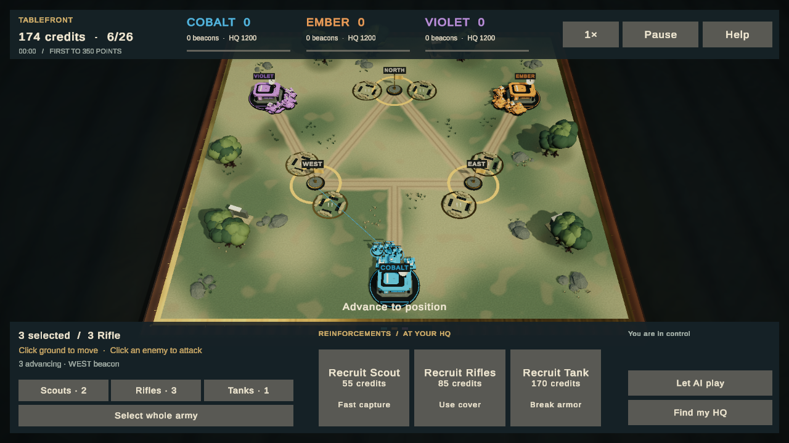
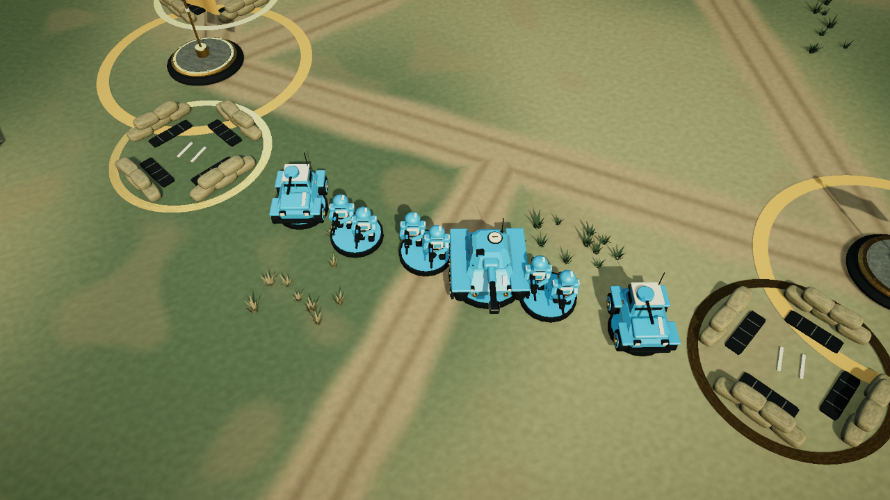
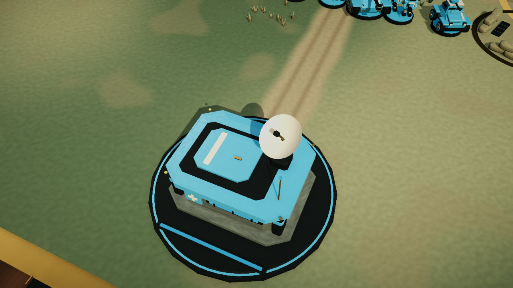
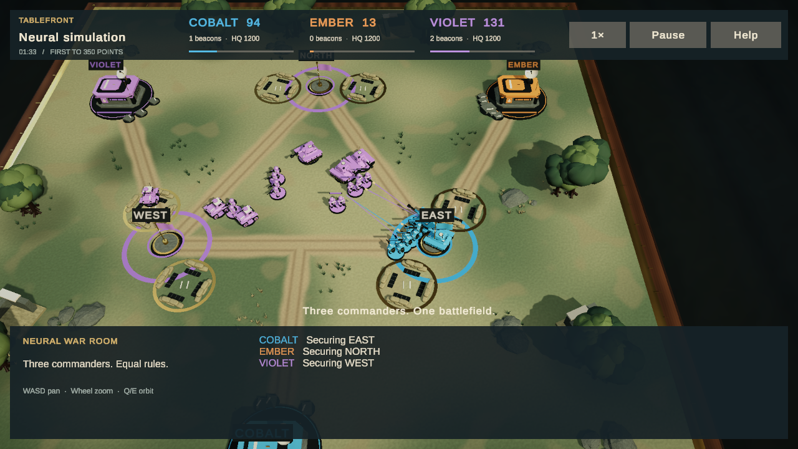

# Tablefront 0.4.0 visual playtest

November 22, 2026. The user approved the premium painted-tabletop direction after a Unity 6.6 documentation review. This pass keeps URP 17.6 and the established walnut, brass, flock and enamel identity while replacing the most obvious primitive-art shapes and surfaces. The goal is readable miniature detail at playing distance, supported by closer inspection views.

## What changed

- **Miniatures:** shared custom meshes provide sloped and chamfered tank armor, turret/track fittings, recon bodywork and wheel pivots, and pairs of articulated armored infantry. Walking legs/knees, wheel rotation, breathing/body response and cannon recoil remain presentation driven by the actual simulation. Reduced motion holds cosmetic poses stable.
- **Landmarks:** headquarters have beveled architecture, faction panels, small fittings and communications dishes. Beacons retain their real ownership pennants; sandbags identify the existing rifle-cover areas. The visual upgrade does not add capture points, obstacles or new protection rules.
- **Terrain:** a continuous textured board replaces flat oval patches and separate straight road slabs. Green/dry flock variation, irregular exposed earth, softer road shoulders and wheel ruts form a coherent surface. Broadleaf groves, slate outcrops and grass clusters frame the routes without filling objective areas.
- **Materials:** shared generated color, normal and metallic/smoothness maps distinguish enamel paint, rubber, walnut, brass and stone. Mesh UVs and tangents support the surface maps. Normal/mask shader variants have Resources references for the player build.
- **Lighting:** a warm key, cool fill and controlled grade preserve faction readability. A real reflection probe captures warm/cool softbox cards that are invisible to the playing camera, giving painted and metallic pieces broader highlights.

## Implementation and boundaries

This is runtime-generated C# art using Unity's existing URP shaders. The new helpers are `TablefrontMiniatureArt`, `TablefrontLandmarkArt`, `TablefrontTerrainArt` and `TablefrontSurfaceArt`, integrated by `TablefrontWorld`. It introduces no packages, external models or textures, license purchases or other costs. Infantry articulation uses generated transform hierarchies; it is not an imported skinned-character animation library.

The relief stays below 0.04 units and flattens near landmarks. Cosmetic scenery adds no colliders and does not alter simulation movement, capture radii, firing rules, protection or AI decisions. Static scenery is combined by shared material, and generated resource ownership is released with the world. The existing desktop startup launcher remains the installation entry point.

The look stays on **URP**. It does not use ray tracing, HDRP, baked global illumination or baked lightmaps. The board is still created at runtime; preparing an authored environment in the Editor would be a separate workflow change if baked lighting is added later. Ambient occlusion was already present before this pass; the improvements come from geometry, surfaces, composition, motion and reflection capture.

## Verification recorded so far

The current evidence contains **233 passing automated checks**: 151 runtime checks and 82 mechanics/tactical checks:

- [25 visual-resource and behavior checks](../TestResults/premium-art-runtime.txt): supported authored shaders, no decorative colliders, finite meshes/bounds, UV/normal/tangent data for mapped surfaces, bound normal/mask textures, a produced reflection texture, static submission count, bounded resources across restarts, real capture/cover feedback and animation/reduced-motion behavior.
- [59 tutorial/control checks](../TestResults/controls-tutorial-runtime.txt).
- [50 StarCraft-style control-group checks](../TestResults/control-groups-runtime.txt).
- [17 missing-target recovery checks](../TestResults/tutorial-target-recovery.txt).
- [57 mechanics checks](../TestResults/premium-mechanics.txt) and [25 tactical checks](../TestResults/premium-tactics.txt), freshly rerun against the current simulation.

The resource check observed **186 owned shared meshes**, with the same count after each of three battle/tutorial restart cycles. The static scenery sample used **14 material-combined renderers**. These are bounded-sample checks, not a long-duration memory or frame-time measurement.

The [layout matrix](../TestResults/premium-layout-matrix.json) records **12 captures**: title, battle and the tutorial attack task at **1024×768, 1280×720, 2560×1440 and 3440×1440**. All recorded TMP overflow probes are empty. It is supplemented by six detail captures for the lineup, tank, rifles, scout, HQ and terrain. Representative battlefield, lineup, HQ and combat frames were visually inspected; this does not claim that every recorded image received an individual review.

The fix pass corrected normalized road/ground blend masks, strengthened broad terrain variation, grouped ground scatter, enabled actual reflection capture, and supplied UV/tangent data to mapped geometry. The graphics configuration explicitly enables `QualitySettings.realtimeReflectionProbes`, since the previous disabled flag prevented reflection capture. Resources material references retain `_NORMALMAP`, `_METALLICSPECGLOSSMAP` and `_OCCLUSIONMAP` player features.

The [Windows build](../TestResults/premium-build-report.json) succeeded with zero errors and warnings in **88.132 seconds**, reporting **107,942,620 bytes**. The [0.3.2 to 0.4.0 per-user upgrade](../TestResults/premium-installer-verification.json) passed: all **190 payload hashes** matched, Windows registration displayed 0.4.0, and desktop/Start menu shortcuts retained the startup-fix launcher. The setup executable is **29,751,527 bytes**. The actual desktop shortcut opened the installed game; [native startup evidence](../TestResults/premium-native-startup.json) records a responding window and completed scene initialization with zero runtime exceptions or shader errors. A read-only 2560×1440 native screenshot showed the new terrain, models and landmarks during tutorial task 3 of 6, with no missing or magenta art observed. No native gameplay input was sent. Native frame rate was not measured.

The combat still came from the normal frozen neural policy at simulation time **93.05 seconds**, with **18 live units** and **four resolved combat events** in the captured event batch. The world was held briefly for a still image by an Editor-only QA helper outside Assets. It is evidence that the visuals render during actual simulated combat, not a native real-time performance test or a new training run.

## Scoped independent frame review

These conservative scores describe the reviewed 1280×720 frames and the related static detail views. They are design-review heuristics, not measured player success or a complete accessibility assessment. No native performance score is inferred from the GPU model or simulation throughput.

Palette discipline: 4/5 — the enamel factions, brass, walnut and ground colors remain coherent; the broad ground still dominates the image.

Style uniformity: 4/5 — units, HQs and terrain share a miniature-diorama treatment; procedural surfaces remain visible on close inspection.

Lighting depth: 3/5 — highlights and cast shadows give pieces form, but broad ground areas remain relatively flat and warm.

Silhouette: 3/5 — tank, recon and paired infantry are distinct in detail captures; fine class cues shrink at normal and wide play zoom.

UI intentionality: 4/5 — existing ink/ivory labels and faction feedback remain consistent; the large command deck and tutorial coach still compete with play space.

Feedback visibility: 3/5 — the combat still shows actual firing traces and ownership rings; small impacts and infantry poses need a human readability check in motion.

| Review dimension | Score / 10 | Evidence and limit |
| --- | --- | --- |
| Usability | 8 | Commands, group shortcuts and lesson gates pass; new-player identification of the upgraded miniatures is not observed |
| Hierarchy | 7 | The board has richer composition, but the existing header/deck/coach can still compete with units |
| Accessibility | 6 | Reduced-motion behavior is verified; complete keyboard world orders, text scaling and assistive-technology support remain open |
| Consistency | 8 | Physical miniature materials, faction colors and visible ownership/protection agree with gameplay; some surface and shape simplicity remains |
| Responsiveness | 7 | Four desktop dimensions render without reported TMP overflow; the scoped visual review is mainly at 1280×720 and smaller-screen comfort is unmeasured |
| Feedback | 8 | Capture, cover, selection and combat signals remain visible and tested; perceived clarity during dense action needs a human check |
| Performance | 6 | Bounded resource counts and combined static renderers are verified; native frame times, latency and VRAM were not measured |

Prioritized follow-ups for the sub-9 findings:

1. Run a dedicated accessibility pass for keyboard world commands, focus/readability, text scaling and contrast; preserve the verified reduced-motion behavior.
2. Observe players identify and command each class at normal zoom, then strengthen the silhouettes and reduce competing HUD information where errors occur.
3. Tune terrain/material separation and lighting depth against the actual playing camera before adding more small decorative geometry.
4. If a more realistic direction is later chosen, evaluate authored soldier meshes, rigs and clips rather than treating procedural articulation as finished character animation.
5. Profile the installed Windows player for frame times, input latency, VRAM and long-run resource behavior; do not infer an FPS target from the render settings or hardware alone.

## Remaining limits

The art remains procedural and stylized. Small units lose fine detail at the widest camera angle; the gameplay camera, class silhouettes and faction colors carry recognition there. Human judgments of attractiveness, readability during dense combat and animation feel remain playtest questions. Native frame times, input latency, VRAM, long-run resource behavior and full accessibility were not measured by these checks. No AAA-quality or native-FPS claim is made.

StarCraft-style groups, mouse commands, named class buttons, the six-task tutorial and missing-target recovery remain available. AI weights are unchanged; AI training and CudaRL integration remain paused. See [controls and tutorial](CONTROLS_TUTORIAL.md).
