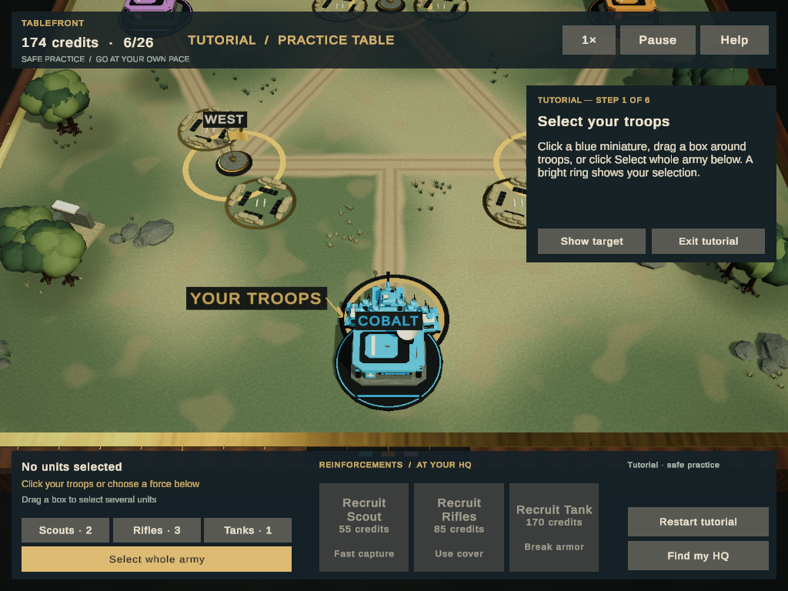
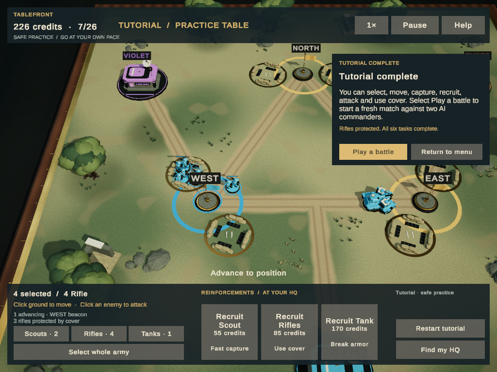

# Tablefront 0.4.1 — tutorial progression fix

[**Download the Windows playtest installer (.exe)**](https://github.com/life423/tablefront/releases/download/v0.4.1-preview.1/Tablefront-Setup-v0.4.1.exe)

Step 5 could repeat indefinitely when your troops destroyed the practice target with automatic fire before an explicit attack click registered. The tutorial now counts the marked target's actual death and advances to the final cover lesson. A target that disappears while still alive is still replaced so the lesson remains recoverable.

During the attack lesson, clicking the marked target takes priority over selecting an overlapping friendly troop. The progress heading now reads **TUTORIAL — STEP 1 OF 6**.

After step 6, choose **Play a battle** to finish the tutorial and start a fresh normal match. **Exit tutorial** returns to the title at any time.

Run Setup and choose Install, then open **Tablefront** from the desktop or Start menu. This patch retains the painted-tabletop graphics from 0.4.0, all ten StarCraft-style control groups and the startup-fix launcher. AI training and CudaRL integration remain paused; the shipped neural weights are unchanged.

The patch passes **83 automated checks**: 59 controls/tutorial checks and 24 target-recovery checks. They cover all six tasks, automatic-fire completion, live-target replacement, clicks through overlapping friendly troops, practice HQ protection and transition to an ordinary match.

Six final Editor captures were visually reviewed: the selection, attack and completion steps at 1024×768 and 2560×1440. All TMP overflow probes were empty. The completion instruction now reads **“Select Play a battle to start a fresh match against two AI commanders.”** Initial large Editor captures required warmup or a fresh Play session to clear capture-path text corruption; the final reviewed frames were clean. These checks do not establish human comprehension, complete accessibility or measured native performance.

The [Windows build](../TestResults/tutorial-fix-build-report.json) succeeded in 7.545 seconds with zero errors and warnings. The [0.4.0 → 0.4.1 installer upgrade](../TestResults/tutorial-fix-installer-verification.json) matched all 190 payload hashes, registered version 0.4.1 and preserved both shortcuts to StartTablefront.exe. The actual desktop shortcut [opened the installed game](../TestResults/tutorial-fix-native-startup.json), created a responsive window and completed scene initialization without runtime exceptions or shader errors. The verification session then closed gracefully; no native gameplay input was sent. Native tutorial rendering and frame rate were not measured in this check.

The Editor console recorded one expected capture warmup error when it opened a Game view before its first rendered frame; subsequent captures succeeded. No game runtime or compilation errors were recorded.

Installer: **Tablefront-Setup-v0.4.1.exe**, 29,748,484 bytes. SHA256: `fafb829952d66e2b374e990af1063c49d07c995ea3c820f7597a82f0e8dfee44`.

