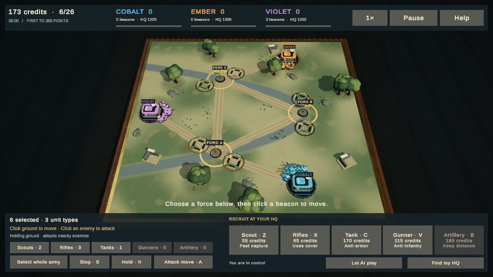
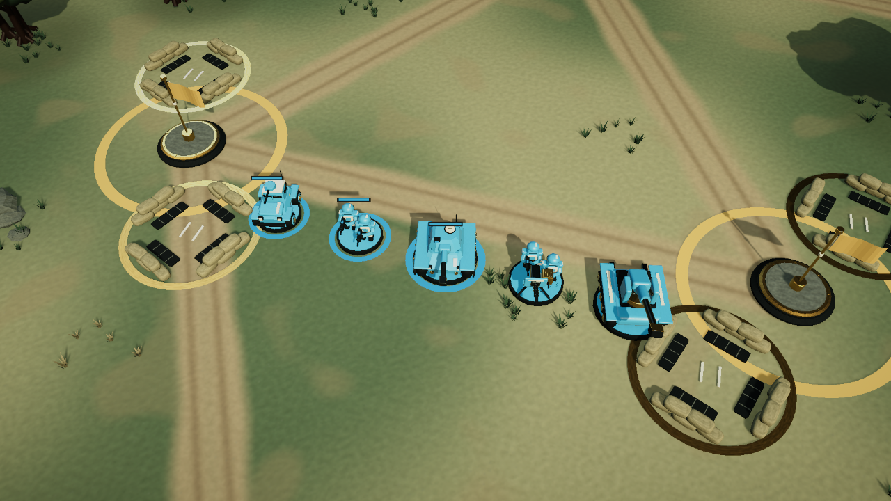

# Tablefront 0.5.0 — expanded skirmishes

[**Download the Windows playtest installer (.exe)**](https://github.com/life423/tablefront/releases/download/v0.5.0-preview.1/Tablefront-Setup-v0.5.0.exe)

This playtest expands Tablefront to **four battlefields and five unit classes**, improves army commands and makes combat easier to read. Windows PC is the primary platform; a tablet edition is deferred. The paid-Windows-v1/free-demo direction is decided, while price, demo boundaries and storefront remain open. This update does not implement sales or a tablet port.

## More battlefields

Choose **Greenfield**, **Ridgeway**, **Dust Basin** or **River Crossing** using Previous / Next on the title screen. Greenfield keeps the original meadow. Ridgeway spreads the objectives across longer reinforcement routes. Dust Basin brings the fight toward central objectives. River Crossing rotates the approaches around three shallow, passable fords.

These are distinct skirmish layouts with the same victory rules, rather than a linear story campaign. **Next battlefield** on the results screen starts a fresh match on the next map; Rematch retains the current map. The six-step tutorial always uses Greenfield and starts normal play on the chosen battlefield afterward.

## More units and clearer combat

- **Gunner — 115 credits:** sustained anti-infantry fire, a shorter reach than Rifles and weak damage against tanks.
- **Artillery — 190 credits:** long-range splash, slow movement and low health, with a **4.5-unit minimum firing distance**. Screen it with other troops.

Scouts, Rifles and Tanks retain their existing roles and prices. All factions start with the same six-unit army, and the added units are paid reinforcements. Every faction shares recruitment, cover, capture and damage rules.

New class models and physical marks on unit bases help distinguish the roster. Stronger selection and hover rings, contextual health bars and brief incoming-hit feedback make orders and combat outcomes clearer. Artillery uses a curved shot trace. Reduced motion suppresses the incoming-hit flash while retaining the health change. The existing painted tabletop style, bounded effect pools and capped audio voices remain.

## Easier RTS controls

| Input | Action |
| --- | --- |
| Click a blue unit / drag a box | Select troops |
| Double-click a blue unit | Select visible friendly troops of the same class |
| Click ground with troops selected | Move; travel takes priority until arrival |
| Click an enemy | Focus fire on that enemy |
| A, then click a destination | Attack-move; engage opponents along the route |
| S | Stop the current order |
| H | Hold position; fire at enemies in range without pursuing |
| Arrow keys / middle drag | Pan the table |
| Mouse wheel / Q–E | Zoom / rotate |
| Z–X–C / V–B | Recruit Scout–Rifle–Tank / Gunner–Artillery |
| Ctrl+0–9 / Shift+0–9 | Save a group / add selected troops to it |
| 0–9 / double-tap 0–9 | Select a group / select and centre it |
| Escape | Cancel an armed order first; otherwise pause |

Visible selection, reinforcement and order buttons remain available. A and S no longer compete with camera movement. Normal movement and attack-move now have distinct behavior, while right-click remains an alternative order input.

## Neural commanders

The **40→32→10** policy and its weights are unchanged. No training or CudaRL integration ran. Strategic decisions still come from the frozen neural policy. An explicit recruitment-role adapter lets its existing infantry/heavy recruitment choices deploy Gunners and Artillery; the new unit types aggregate into the existing role observations. That adapter is game logic, not newly learned unit selection. The old policy has not learned the new maps or unit counters.

See [expanded rules and limitations](EXPANDED_SKIRMISH_RULES.md) and [product direction](PRODUCT_DIRECTION.md).

## Verification recorded during implementation

| Check group | Passing checks |
| --- | ---: |
| Expanded map/unit/order rules | 55 |
| Mechanics regressions | 63 |
| Tactical regressions | 25 |
| Neural compatibility | 24 |
| Expanded art integration | 35 |
| Expanded controls integration | 36 |
| Expanded HUD integration | 23 |
| Six-step tutorial and original mouse controls | 59 |
| Control groups | 50 |
| Tutorial target recovery | 24 |

[Frozen neural evaluation](../TestResults/expanded-skirmish-simulation.json) completed **24/24 matches across the four maps**, with zero timeouts or invalid states, and every match deployed expanded units. [Compatibility checks](../TestResults/expanded-neural.txt) also completed all 12 original-map matches, with zero action mismatches in 10,000 seeded comparisons. The optional trainer compiled but was never executed. Historical baseline output files were preserved.

Evidence: [mechanics](../TestResults/expanded-mechanics.txt), [tactics](../TestResults/expanded-tactics.txt), [art](../TestResults/expanded-art-runtime.txt), [controls](../TestResults/expanded-controls-runtime.txt), [HUD](../TestResults/expanded-hud-runtime.txt), [tutorial](../TestResults/controls-tutorial-runtime.txt), [groups](../TestResults/control-groups-runtime.txt), [recovery](../TestResults/tutorial-target-recovery.txt).

These groups total **394 passing checks**. The 24-state Editor layout matrix covers title, battle, Help, shortcuts, tutorial attack and completion at 1024×768, 1280×720, 2560×1440 and 3440×1440; all TMP overflow probes were empty. Individual visual review covered all six minimum-size and native-1440p states, ultrawide battle/tutorial, all four map overviews, the five-unit lineup, new-unit closeups and combat. Additional minimum-size Pause, results and Artillery-selection frames fit. A fresh Play session resolved an ultrawide capture-path text artifact. The River Crossing opening camera was adjusted and checked so HQs stay between header and deck. Some earlier composed opening captures had text-capture artifacts and are not claimed as clean UI proofs.

The [Windows build](../TestResults/expanded-build-report.json) succeeded in **7.706 seconds**, with zero build errors or warnings and **107,967,716 bytes**. Final Editor compilation and console state had zero current errors/warnings. The retained console history includes an expected Game-view warmup error and one resolved compilation error during the artillery copy fix; failed attempts are not counted as passes.

The [installer upgrade](../TestResults/expanded-installer-verification.json) from 0.4.1 to 0.5.0 matched all **190 payload hashes**, registered the correct version and preserved the desktop and Start menu shortcuts. The actual desktop shortcut [opened the installed game](../TestResults/expanded-native-startup.json); its 2560×1440 title and map chooser were visually inspected and scene initialization completed without runtime exceptions or shader errors. It is left at the title for the user. No native gameplay input was sent.

The [explicit native benchmark](../TestResults/expanded-native-benchmark.json) sampled 30 seconds of Dust Basin spectator play after an eight-second warmup, including opening Gunners and Artillery. On the RTX 5070 / i7-13700KF at **2560×1440**, normal VSync, **1.5× render scale**, **8× MSAA** and the **8192 shadow atlas**, Unity player-loop frame intervals averaged **143.7 FPS**; median/p95/p99 were **6.946/6.966/6.985 ms**. The simulation advanced for the entire sample without pausing, with up to 28 live units. This is a short ordinary-battle sample, not a maximum-army, long-run, VRAM, input-latency, presented-frame or tablet benchmark.

To repeat the optional local sample with the game closed, run `StartTablefront.exe -tablefront-benchmark`. It writes `tablefront-benchmark.json` under the game's local persistent-data folder, restores the saved map preference and closes automatically. Ordinary launches do not enable it; it sends no analytics. The launcher forwards only this allowlisted flag and retains the startup and existing-instance fixes.

Installer **Tablefront-Setup-v0.5.0.exe**: **29,760,435 bytes**, SHA256 `04f9e5a5d12b103cee676f4277132843ea7fbfa493277541bdde1d373bea3a90`.

Human comprehension, ideal difficulty, full accessibility and tablet performance remain unvalidated. Craft review: palette 4/5, style 4, lighting 3, silhouette 4, UI 3 and feedback 3. Priorities are human replay, wide-view class recognition and adjustable text size, audio listening, and larger/longer performance samples. Skills used: Unity CLI, uGUI and craft-game-floors (playable-loop, game-feel and visual-scorecard); version-matched Unity Camera.WorldToScreenPoint and Input System 1.20 documentation were consulted. No packages, external art purchases, training runs or tablet builds were introduced.

