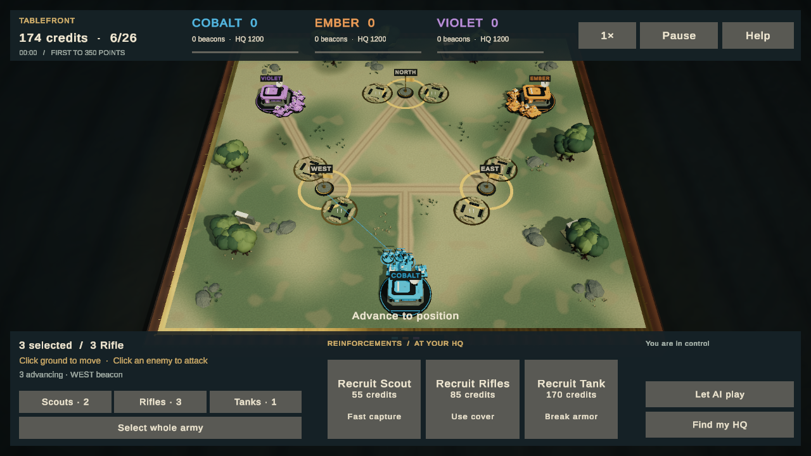

# Tablefront

A Windows tabletop RTS made in Unity. Command a miniature army against two neural commanders, or watch all three fight through self-play tactics.

The **0.5.0 playtest** adds four selectable battlefields, a five-unit roster, clearer combat feedback and familiar RTS orders: **A** for attack-move, **S** to stop and **H** to hold. [Download the Windows installer](https://github.com/life423/tablefront/releases/download/v0.5.0-preview.1/Tablefront-Setup-v0.5.0.exe) or read the [update notes](Docs/RELEASE_v0.5.0.md). The six-step tutorial, ten control groups and painted miniature-tabletop graphics remain included. The stable release remains 0.2.1 while the expanded game receives human playtesting.

**Windows PC comes first; tablet comes later.** The product plan is a paid Windows v1 with a free demo; pricing is undecided. The current preview is free to download. A tablet port, storefront and payment flow have not been implemented. See [product direction](Docs/PRODUCT_DIRECTION.md).

## Play

1. [Download the 0.5.0 Windows playtest](https://github.com/life423/tablefront/releases/download/v0.5.0-preview.1/Tablefront-Setup-v0.5.0.exe).
2. Double-click **Tablefront-Setup-v0.5.0.exe** and choose **Install**.
3. Open **Tablefront** from the desktop icon or Start menu.
4. Choose **Tutorial · Start here** to learn by playing. For a normal match, choose a battlefield using **Previous / Next**, then **Play vs AI**. **Watch AI battle** runs three neural commanders. After a match, **Next battlefield** starts a fresh battle on the next map.

The installer includes all the game files and creates desktop and Start menu shortcuts by default. It installs for your Windows account without an administrator prompt. You can remove it through **Settings → Apps → Installed apps → Tablefront → Uninstall**.

Unity, the .NET SDK, an account, and an internet connection are not required to play. The small launcher uses the .NET Framework included with Windows. Installer build instructions are in [Installer/README.md](Installer/README.md).

**Click a blue unit** to select it, or choose a class or **Select whole army** below the table. Then **click ground to move** or **click an enemy to attack**. A normal move prioritizes travelling to its destination. For fighting along the way, press **A**, then click a destination. Keep troops inside a beacon's ring to capture it. Beacons earn credits and victory points. Reach **350 points**, or destroy both enemy headquarters.

Prefer the older stable build? [Download 0.2.1](https://github.com/life423/tablefront/releases/download/v0.2.1/Tablefront-Setup-v0.2.1.exe). Its controls differ: right-click gives orders, 1/2/3 recruit and Tab switches the commander. The controls below describe 0.5.0.

## Controls

| Input | Action |
| --- | --- |
| Left-click a blue unit / drag a box | Select your units |
| Double-click a blue unit | Select visible friendly troops of the same class |
| Left-click ground / enemy with troops selected | Move in formation / attack that enemy |
| A, then click ground | Attack-move: advance and engage along the route |
| S / H | Stop / hold position and fire without pursuing |
| Scouts / Rifles / Tanks / Gunners / Artillery buttons | Select that troop class |
| Recruit buttons | Buy reinforcements at your HQ |
| Shift + select | Add or remove units from the selection |
| Right-click ground / enemy | Alternative move / attack |
| Select whole army / Ctrl+A | Select your whole army |
| Ctrl+0–9 | Save or replace that control group with the selected units |
| Shift+0–9 | Add selected units to that control group |
| 0–9 | Select a saved control group |
| Double-tap 0–9 | Select the group and center the camera on it |
| Z / X / C | Recruit Scout / Rifle / Tank at your HQ |
| V / B | Recruit Gunner / Artillery at your HQ |
| Arrow keys | Pan the camera |
| Mouse wheel | Zoom |
| Q / E | Rotate the view |
| Middle mouse drag | Pan with the mouse |
| Home | Focus your HQ |
| F | Focus the current HQ/beacon alert |
| Let AI play / Take control button | Explicitly hand over / reclaim command |
| Tab / Shift+Tab | Focus the next / previous visible UI control |
| Enter | Activate the focused button |
| Space / Escape | Pause; Escape first cancels an armed order, and Space activates a focused UI control instead |
| Help / F1 | Open Help during a battle |
| F11 | Toggle fullscreen |

Recruitment shares a short cooldown; each army can field **26 units**. If your HQ falls, you can watch the remaining battle or restart. Switching away from the game pauses the match. Help includes volume and reduced-motion settings. Camera panning uses the arrow keys or middle drag so A and S remain available for army commands.

To split your infantry into squads, drag-select some Rifles and press **Ctrl+1**. Select another squad and press **Ctrl+2**. Press **1** or **2** to select those squads later; **Shift+1** adds the current selection to group 1. Named class buttons select a whole troop class. Numbers select saved groups. You can play without shortcuts; **Help → Keyboard shortcuts** lists the optional controls.

## Battlefields and units

Choose any of four skirmish maps from the title screen. These are distinct battle layouts with the same victory rules, rather than chapters of a story campaign.

| Battlefield | Main difference |
| --- | --- |
| Greenfield | The original balanced meadow and tutorial layout |
| Ridgeway | Widely spaced objectives and longer reinforcement routes |
| Dust Basin | Central objectives and a compact battle line |
| River Crossing | Rotated approaches around three shallow, passable fords |

| Unit | Credits | Role |
| --- | ---: | --- |
| Scout | 55 | Fast movement and faster capture |
| Rifle | 85 | Flexible infantry; takes 35% less damage in marked cover |
| Tank | 170 | Durable armour, anti-tank gun and light splash |
| Gunner | 115 | Sustained anti-infantry fire; weak against tanks |
| Artillery | 190 | Long-range splash; slow and fragile, with a 4.5-unit firing dead zone |

All factions start with the same original six-unit army. Gunners and Artillery are paid reinforcements. The [expanded rules](Docs/EXPANDED_SKIRMISH_RULES.md) document exact mechanics and verification.

## Tutorial

Choose **Tutorial** on the title screen, **Start tutorial** in Help, or **Tutorial** while paused. Gold markers and one instruction at a time guide you through selecting troops, moving, capturing WEST, recruiting rifles, destroying a practice target and protecting rifles in cover. Each task waits for the action to happen in the real simulation.

Practice always uses Greenfield, independently of your selected battle map. It has no opposing commander activity or score victory pressure. The attack target stays still and does not fire. Destroying it completes step 5, including when your troops fire automatically. **Show target** recenters the view; **Restart tutorial** starts the lesson over; **Exit tutorial** returns to the title. After step 6, **Play a battle** starts a fresh normal match on the selected battlefield. See the [tutorial guide](Docs/CONTROLS_TUTORIAL.md).

## Neural commanders

The opponents use a **40 → 32 tanh → 10 softmax** neural policy trained by **Proximal Policy Optimization (PPO)**. It learned through **2,048 three-faction self-play episodes**, sampling **726,762 decisions**. All factions share the trained weights with independent random streams.

The network chooses capture, assault, defense, recruitment and whether to keep current orders. Movement, targeting, firing, damage, capture and economy follow the same game rules for players and AI. There is no scripted strategic fallback. The policy is **frozen during gameplay**.

**No new training was run for 0.5.0.** An explicit recruitment-role adapter gives the neural commanders access to Gunners and Artillery through their existing infantry/heavy recruitment choices. Gunners aggregate into the existing infantry observation and Artillery into heavy units. That compatibility logic is not learned unit selection, and the old weights have not learned the new maps or counters. Training and CudaRL integration remain paused.

Historical held-out evaluation on the original roster rotated the trained agent through all three starting positions:

| Matchup | Trained agent wins |
| --- | --- |
| Against two random-action opponents | 95 / 120 |
| Against two untouched, untrained neural opponents | 99 / 120 |
| Untrained-versus-random control | 36 / 120 |

Those results show improvement over the original baselines, not expert RTS play or proven balance for the expanded roster. New frozen-inference checks completed **24/24 matches across the four maps** with no timeout or invalid state; these establish liveness, not difficulty or human fun. The [training guide](Training/README.md), [historical evaluation](Training/unity-trained/evaluation.json), [expanded rules](Docs/EXPANDED_SKIRMISH_RULES.md) and [validation notes](Docs/VALIDATION.md) describe the method and limits.

## Graphics

The visual playtest keeps **Unity 6.6 / URP 17.6** and the existing native-display, supersampling, MSAA and sharp-overlay configuration. Custom miniature meshes, surface maps, continuous terrain, articulated motion and studio reflections establish the tabletop look. The expanded roster adds distinct models and physical class marks. Stronger selection/hover rings, contextual health bars, incoming-hit feedback and curved artillery traces improve combat readability. All art remains runtime-generated; it introduces no external asset purchases or new packages, and does not use ray tracing or baked GI. See [art direction](Docs/ART_DIRECTION.md) and [the visual update](Docs/PREMIUM_TABLETOP.md). A [30-second native sample](TestResults/expanded-native-benchmark.json) averaged 143.7 FPS at 2560×1440 on the RTX 5070 with 1.5× supersampling and 8× MSAA; it is not a maximum-army stress test or VRAM measurement.

## Edit or train

Open the project in **Unity 6000.6.10f1** using Unity Hub. The project uses **URP 17.6**, the Input System, Cinemachine, and TextMeshPro/uGUI.

| Location | Contents |
| --- | --- |
| `Assets/Scenes/Tablefront.unity` | Entry scene |
| `Assets/Scripts` | Runtime game and simulation |
| `Assets/Resources/commander-policy.json` | Shipped neural policy |
| `Training` | PPO trainer, checkpoint, metrics, and instructions |
| `AgentScripts` | Editor construction and verification tools |
| `Docs` | Art direction and verification records |

Training is optional. The small CPU trainer uses **.NET SDK 9.0.304** and the installed Unity Editor's math assembly. It compiles the exact `Assets/Scripts/BattleSimulation.cs` used by the game. The Windows build script currently assumes standard tool installation paths; update those paths if your installations differ. See [Training/README.md](Training/README.md) to reproduce or continue training, then replace the Resources policy and rebuild to play with new weights.
