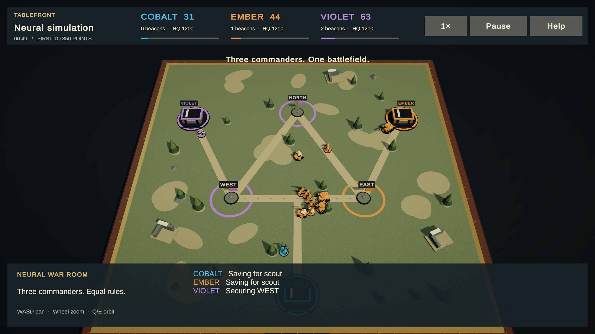

# Tablefront

A Windows tabletop RTS made in Unity. Command a miniature army against two neural commanders, or watch all three fight through self-play tactics.

## Play

1. Open the [latest release](https://github.com/life423/tablefront/releases/latest) and download the Windows ZIP.
2. Right-click the ZIP and choose **Extract All**.
3. Open the extracted folder and double-click **Tablefront.exe**. Keep its adjacent files and folders together.
4. Choose **Play vs AI** to command Cobalt, or **Watch AI battle** to spectate.

Unity, .NET, an account, and an internet connection are not required to play the release build. You can create your own desktop shortcut by right-clicking the extracted `Tablefront.exe` and choosing **Show more options → Send to → Desktop (create shortcut)**.

Your six starting units are selected. **Right-click a beacon** to advance. Keep units inside its ring to capture it; units fire at nearby enemies automatically. Beacons earn credits and victory points. Reach **350 points**, or destroy both enemy headquarters.

## Controls

| Input | Action |
| --- | --- |
| Left-click / drag a box | Select your units |
| Shift + select | Add or remove units from the selection |
| Right-click ground / enemy | Move in formation / focus fire |
| Ctrl+A | Select your whole army |
| 1 / 2 / 3 | Recruit Scout / Rifle / Tank at your HQ |
| WASD / arrows | Pan the camera |
| Mouse wheel | Zoom |
| Q / E | Rotate the view |
| Middle mouse drag | Pan with the mouse |
| Home | Focus your HQ |
| Tab | Hand your army to its neural commander / take command back |
| Space / Escape | Pause |
| F1 | Open Help |
| F11 | Toggle fullscreen |

Scouts cost **55 credits**, rifles **85**, and tanks **170**. Recruitment shares a short cooldown; each army can field **26 units**. If your HQ falls, you can watch the remaining battle or restart. Switching away from the game pauses the match. Help includes volume and reduced-motion settings.

## Neural commanders

The opponents use a **40 → 32 tanh → 10 softmax** neural policy trained by **Proximal Policy Optimization (PPO)**. It learned through **2,048 three-faction self-play episodes**, sampling **726,762 decisions**. All factions share the trained weights with independent random streams.

The network chooses capture, assault, defense, recruitment, and holding orders. Movement, targeting, firing, damage, capture, and economy follow the same game rules for players and AI. There is no scripted strategic fallback. The policy is **frozen during gameplay**; it learns further when the included trainer runs again.

Held-out evaluation rotated the trained agent through all three starting positions:

| Matchup | Trained agent wins |
| --- | --- |
| Against two random-action opponents | 95 / 120 |
| Against two untouched, untrained neural opponents | 99 / 120 |
| Untrained-versus-random control | 36 / 120 |

These results show improvement over those baselines, not expert RTS play or proven balance against people. The included [training guide](Training/README.md), [evaluation](Training/unity-trained/evaluation.json), and [validation notes](Docs/VALIDATION.md) describe the method and limits.

## Graphics

The high-quality desktop preset targets a **2560 × 1440 display**, with supersampling, MSAA, detailed tabletop textures, anisotropic filtering, and sharp overlay UI. It is intended for capable desktop GPUs; no measured frame-rate guarantee is provided. See the [release notes](RELEASE_NOTES.md) for the graphics configuration included in the release.

## Edit or train

Open the project in **Unity 6000.6.10f1** using Unity Hub. The project uses **URP 17.6**, the Input System, Cinemachine, and TextMeshPro/uGUI.

| Location | Contents |
| --- | --- |
| `Assets/Scenes/Tablefront.unity` | Entry scene |
| `Assets/Scripts` | Runtime game and simulation |
| `Assets/Resources/commander-policy.json` | Shipped neural policy |
| `Training` | PPO trainer, checkpoint, metrics, and instructions |
| `AgentScripts` | Editor construction and verification tools |
| `Docs` | Art direction and verification records |

Training is optional. The small CPU trainer uses **.NET SDK 9.0.304** and the installed Unity Editor's math assembly. It compiles the exact `Assets/Scripts/BattleSimulation.cs` used by the game. The Windows build script currently assumes standard tool installation paths; update those paths if your installations differ. See [Training/README.md](Training/README.md) to reproduce or continue training, then replace the Resources policy and rebuild to play with new weights.
